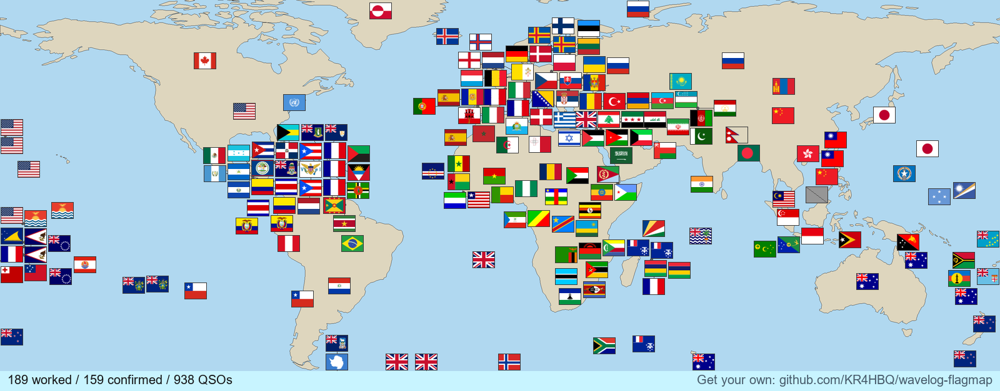

# wavelog-flagmap

Flag Counter-style images of the DXCC entities you've worked, generated from your
[Wavelog](https://github.com/wavelog/wavelog) log. Built for pasting into a QRZ.com bio or a website,
where JavaScript and iframes won't work: the output is plain PNG files.

| Flag grid | World map |
|---|---|
|  |  |

*(Synthetic sample data, generated by `examples/make_sample.py`.)*

## Features

- Reads your log from the **Wavelog API** (no database access needed) or from any **ADIF file**.
- Counts QSOs **or confirmed QSOs** (LoTW / QSL / eQSL) per DXCC entity.
- Real DXCC entities, not just countries: Hawaii, Scotland, Sicily and so on, each with its own flag.
- Fully offline rendering. Flags and map data are bundled, with no CDN calls.
- Writes `dxcc-grid.png`, `dxcc-map.png` and `dxcc-stats.json`, replacing files atomically so a web server never serves a half-written image.
- Light and dark themes.

## Install

```bash
pip install git+https://github.com/KR4HBQ/wavelog-flagmap
```

Python 3.9+. Or use the included `Dockerfile`.

## Quick start

From an exported ADIF:

```bash
wavelog-flagmap --adif my-log.adi --callsign N0CALL -o ./out
```

From your Wavelog instance:

```bash
cp examples/config.example.yaml config.yaml    # edit url, station_id, callsign
export WAVELOG_API_KEY=...                     # a read-only key (Wavelog > API Keys)
wavelog-flagmap -c config.yaml
```

`station_id` is the numeric Station Location ID. Find it in Wavelog under *Station Locations*.

## Embed in QRZ

QRZ bios accept basic HTML and externally hosted images. Host the PNGs somewhere public
(your website, an S3/Cloudflare bucket, GitHub Pages) and add to your bio:

```html


```

The filenames never change, so the bio never needs editing again. Re-run the tool on a schedule and
the images update. QRZ and browsers may cache images for a while.

## Run it on a schedule

```cron
# nightly at 03:15
15 3 * * *  WAVELOG_API_KEY=xxxx /usr/local/bin/wavelog-flagmap -c /etc/flagmap/config.yaml
```

Point `output_dir` at a web server's document root, or add a copy/upload step after the run.

Docker:

```bash
docker build -t wavelog-flagmap .
docker run --rm -e WAVELOG_API_KEY -v $PWD/config.yaml:/config/config.yaml:ro -v $PWD/out:/out wavelog-flagmap
```

## Configuration

See [`examples/config.example.yaml`](examples/config.example.yaml). Common options:

| Key | Meaning |
|---|---|
| `metric` | `qsos` (default) or `confirmed` |
| `theme` | `light` or `dark` |
| `grid.rows`, `grid.max_entries` | entries per column and total shown in the grid |
| `map.width`, `map.flag_w`, `map.flag_h` | map image size and flag size |

## Limitations

- Map flag positions are the AD1C cty.dat reference points for each entity (one point per entity,
  so large countries show a single flag). Flags in crowded regions (Europe, Caribbean) are spread
  apart with a leader line to the true position.
- Some entities have no national flag (a grey placeholder is drawn).
- The v1 client (`api: v1`, `POST /index.php/api/get_contacts_adif`) matches the request and
  response format of Wavelog's `Api` controller. The **v2** client (`api: v2`, a `wl2_` token with
  the `qso:read` scope, Wavelog 3.1.0+) is written from the v2 API docs and is **experimental** until
  checked against a live instance. Please file an issue if your instance behaves differently.

## Development

```bash
pip install -e ".[dev]"
pytest
python scripts/build_data.py --help      # maintainers: regenerate bundled data
```

## License

MIT. See [LICENSE](LICENSE) and [THIRD_PARTY_NOTICES.md](THIRD_PARTY_NOTICES.md) for bundled data.
