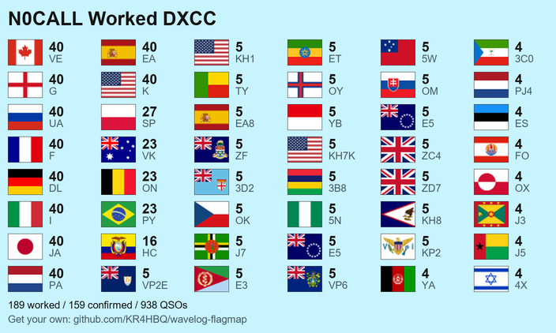

# wavelog-flagmap

Flag Counter-style images of the DXCC entities you've worked, generated from your
[Wavelog](https://github.com/wavelog/wavelog) log, LoTW or any logger's ADIF export. Built for pasting into a QRZ.com bio or a website,
where JavaScript and iframes won't work: the output is plain PNG files.

| Flag grid | World map |
|---|---|
|  |  |

*(Synthetic sample data, generated by `examples/make_sample.py`.)*

## Features

- Reads your log from the **Wavelog API** (no database access needed), straight from **LoTW**, **Club Log**
  or the **QRZ Logbook** (QRZ subscribers), or from an
  **ADIF file exported by any logger** (Log4OM, N1MM+, HRD, DXKeeper, Cloudlog, QRZ Logbook, Club Log...),
  either a local file or a public URL.
- Counts QSOs **or confirmed QSOs** (LoTW / QSL / eQSL / QRZ / Club Log, your choice) per DXCC entity.
- Real DXCC entities, not just countries: Alaska, Hawaii, Scotland, the Canary Islands and so on.
  QSOs without a DXCC field are placed from the callsign (AD1C cty.dat prefixes and exception list).
- Fully offline rendering. Flags and map data are bundled, with no CDN calls.
- Writes `dxcc-grid.png`, `dxcc-map.png` and `dxcc-stats.json`, replacing files atomically so a web server never serves a half-written image.
- Light and dark themes.

## Install

```bash
pip install git+https://github.com/KR4HBQ/wavelog-flagmap
```

Python 3.10+. Or use the included `Dockerfile`.

## Quick start

From an exported ADIF (any logger), a local file or a public URL:

```bash
wavelog-flagmap --adif my-log.adi --callsign N0CALL -o ./out
wavelog-flagmap --adif https://example.org/my-log.adi --callsign N0CALL -o ./out
```

From ARRL Logbook of The World:

```bash
export LOTW_USERNAME=n0call LOTW_PASSWORD=...
wavelog-flagmap --source lotw --callsign N0CALL -o ./out
```

LoTW returns every QSO you uploaded, so "confirmed" means confirmed in LoTW (paper QSLs are not
known to LoTW). If your account has several callsigns, `--lotw-owncall N0CALL` keeps one.
LoTW is slow to answer (about 3 minutes for 5,000 QSOs); that is normal.

From Club Log (make a token under Club Log *Settings > API*) or the QRZ Logbook (needs a QRZ
subscription; the key is on your logbook's *Settings* page):

```bash
export CLUBLOG_TOKEN=cl_...
wavelog-flagmap --source clublog --callsign N0CALL -o ./out    # the log of N0CALL
export QRZ_LOGBOOK_KEY=XXXX-XXXX-XXXX-XXXX
wavelog-flagmap --source qrz --callsign N0CALL -o ./out
```

With QRZ, `--confirmed-by qrz` counts QSOs confirmed in the QRZ Logbook.

From your Wavelog instance:

```bash
cp examples/config.example.yaml config.yaml    # edit url, station_id, callsign
export WAVELOG_API_KEY=...                     # a read-only key (Wavelog > API Keys)
wavelog-flagmap -c config.yaml
```

`station_id` defaults to `all`: every Station Location of the API key's user, so new portable/POTA
locations are picked up automatically (if you enabled *active logbook only* in Wavelog's station settings,
only the locations linked to your active logbook). To pick specific ones, use the numeric IDs from the
*Station Locations* page: `1`, `1,3,5` or `1-12`.

Without a config file:

```bash
wavelog-flagmap --url https://log.example.com --callsign N0CALL -o ./out
```

## Publish nightly with GitHub Pages (no server needed)

The included [`publish` workflow](.github/workflows/publish.yml) renders your images every night on
GitHub's runners and serves them from GitHub Pages. It reads Wavelog, LoTW or an ADIF file at a URL
(a Wavelog instance must be reachable from the internet).

1. Fork this repository (or copy `.github/workflows/publish.yml` and `scripts/site_index.py` into your own).
2. *Settings > Secrets and variables > Actions*: the **variable** `CALLSIGN`, optionally `FLAGMAP_ARGS`
   (extra flags, e.g. `--map-view full --theme dark`; see `wavelog-flagmap --help`), and one source:
   - **Wavelog**: variable `WAVELOG_URL` (e.g. `https://log.example.com`), secret `WAVELOG_API_KEY`
     (a read-only v1 key; Wavelog: your callsign menu > *API Keys*), optional variable `WAVELOG_STATION_ID`
     (default `all`).
   - **LoTW**: variable `LOTW_USERNAME`, secret `LOTW_PASSWORD`.
   - **Club Log**: secret `CLUBLOG_TOKEN` and variable `FLAGMAP_SOURCE` = `clublog` (the log of `CALLSIGN`).
   - **QRZ Logbook**: secret `QRZ_LOGBOOK_KEY` and variable `FLAGMAP_SOURCE` = `qrz`.
   - **ADIF URL**: variable `ADIF_URL`, a public link to an ADIF export from any logger (re-export it when
     you want the images to catch up).

   With more than one configured, Wavelog wins over LoTW over the ADIF URL; the variable
   `FLAGMAP_SOURCE` (`wavelog`, `lotw` or `adif`) picks one explicitly.
3. *Settings > Pages > Build and deployment > Source*: **GitHub Actions**.
4. In the repository's top **Actions** tab (not *Settings > Actions*): *publish > Run workflow* once to
   publish right away. The run can take a minute to appear in the list.

The images are then at `https://<user>.github.io/<repo>/dxcc-grid.png` and `.../dxcc-map.png`.

**Custom domain (optional):** add a DNS `CNAME` record such as `flagmap.example.com -> <user>.github.io`,
then enter the name under *Settings > Pages > Custom domain* (the field appears once the source is
*GitHub Actions*) and tick *Enforce HTTPS*. On Cloudflare,
set the record to *DNS only* (grey cloud) so GitHub can issue the certificate and nightly updates are not
held in Cloudflare's cache.

## Embed in QRZ

QRZ bios accept basic HTML and externally hosted images. Add to your bio:

```html
<a href="https://<user>.github.io/<repo>/">.github.io/<repo>/dxcc-grid.png" alt="Worked DXCC" style="max-width:100%;height:auto"></a>
.github.io/<repo>/dxcc-map.png" alt="DXCC map" style="width:100%;height:auto">
```

The filenames never change, so the bio never needs editing again. QRZ and browsers may cache images
for a while (GitHub Pages: about 10 minutes).

## Or run it on your own server

```cron
# nightly at 03:15
15 3 * * *  WAVELOG_API_KEY=xxxx /usr/local/bin/wavelog-flagmap -c /etc/flagmap/config.yaml
```

Point `output_dir` at a web server's document root, or add a copy/upload step after the run.

Docker:

```bash
docker build -t wavelog-flagmap .
docker run --rm -e WAVELOG_API_KEY -v $PWD/config.yaml:/config/config.yaml:ro -v $PWD/out:/out wavelog-flagmap
```

## Configuration

See [`examples/config.example.yaml`](examples/config.example.yaml). Common options:

| Key | Meaning |
|---|---|
| `metric` | `qsos` (default) or `confirmed` |
| `confirmed_by` | QSL sources that count as confirmed: `lotw`, `qsl`, `eqsl`, `qrz`, `clublog`, `dcl` (default `lotw,qsl`, as ARRL DXCC and Wavelog's DXCC page) |
| `theme` | `light` or `dark` |
| `grid.rows`, `grid.max_entries`, `grid.labels` | entries per column, total shown, and `prefix`/`none` under each count |
| `map.view` | `cropped` (default: drops the empty polar strips so flags can be bigger; Svalbard, Franz Josef Land and Antarctic entities are pinned to the edge) or `full` (84°N to 58°S) |
| `map.width`, `map.flag_w`, `map.flag_h` | map image size and flag size (defaults 1600, 36x27: sized to look right when a QRZ bio shows the map at ~800 px) |

## Limitations

- QSOs are placed by their ADIF `DXCC` field when present (Wavelog and most loggers fill it in).
  Without it, the entity comes from the callsign. That matches the logger's own assignment for about
  99.9% of QSOs; the exceptions are mostly US hams who moved but kept a KL7, KH6 or KP4 call.
- Cloudlog has no full-log export API, so Cloudlog users export an ADIF file instead. Downloading from the
  QRZ Logbook API needs a QRZ subscription.

- Map flag positions are the AD1C cty.dat reference points for each entity (one point per entity,
  so large countries show a single flag). Flags in crowded regions (Europe, Caribbean) are spread
  apart with a leader line to the true position.
- UN HQ (4U1U) and ITU HQ (4U1I) show the UN flag, SMOM (1A) its red-and-white state flag and Market Reef (OJ0)
  the flag of Aland. Spratly Islands has no flag (a grey placeholder is drawn).
- The v1 client (`api: v1`, `POST /index.php/api/get_contacts_adif`) matches the request and
  response format of Wavelog's `Api` controller. The **v2** client (`api: v2`, a `wl2_` token with
  the `qso:read` scope, Wavelog 3.1.0+) returns the same QSOs. Both were checked against a live
  instance. Please file an issue if yours behaves differently.

## Development

```bash
pip install -e ".[dev]"
pytest
python scripts/build_data.py --help      # maintainers: regenerate bundled data
```

## License

MIT. See [LICENSE](LICENSE) and [THIRD_PARTY_NOTICES.md](THIRD_PARTY_NOTICES.md) for bundled data.
